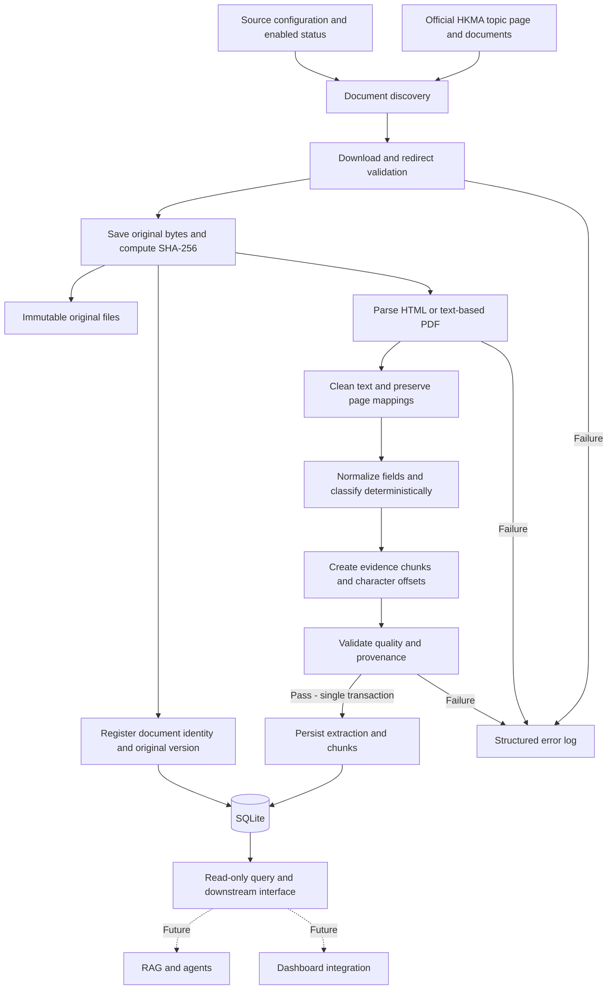
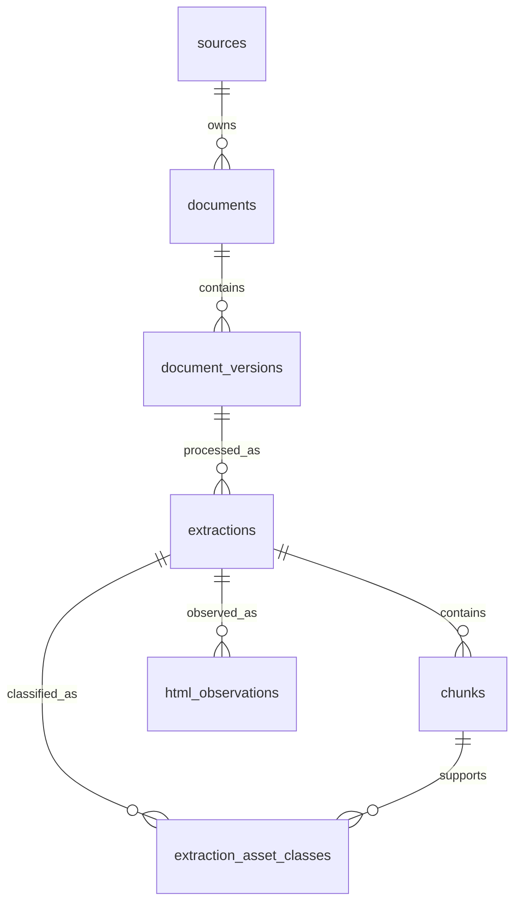

# Regulatory Data Pilot Architecture

The design uses a single-process pipeline, immutable original files and SQLite. As of 2026-10-16, it supports two fixed PDFs and English press-release discovery from the topic page, with single-document or bounded batch execution using [schema](../db/schema.sql) v2. HTML text is extracted from verified article containers with CSS-selector metadata evidence. Read-only queries are implemented; semantic retrieval and model generation are pending. See the [pilot scope](pilot_scope.md), [data dictionary](data_dictionary.md) and [ingestion guide](ingestion.md).

Compatibility: preserve existing records, default targets and CLI arguments. The parser rule is hkma_regulatory_pdf_html_v3. Reprocessing an existing PDF after code changes creates a new extraction while reusing its document and identical-byte version. HTML uses text/html and nullable page fields; metadata_evidence.body.locator holds its body selector, while section remains reserved for original headings or clause numbers. Preserve historical manifests, chunks and originals. Existing v1 databases use migrate-db to add html_observations, without reinitialization. Response observations and extraction evidence are separate; see [HTML change detection](html_incremental.md).

## Data Flow



## Modules and Contracts

| Module | Input and output | Responsibility |
|---|---|---|
| Source configuration | `config/sources.yaml` to sources | Validate regulator, jurisdiction, entry point and enabled status; asset_focus guides discovery only |
| Collector | Enabled configuration to candidate URLs and parent_url | Source-specific discovery and scope checks; no full-text parsing or database writes |
| Fetcher | Candidate URL to bytes, final URL, MIME and collection time | Timeouts, finite retries, explicit User-Agent and conservative frequency; validate each redirect host |
| Original storage | Response bytes to content_sha256 and raw_path | Content-addressed atomic publication; reject overwriting different content |
| Identity registration | Canonical URL and original to documents/document_versions | Deduplicate stable identities; preserve downloaded originals even if parsing has not succeeded |
| Parser | Original to raw_text and page/section mappings | Extract HTML article text and preserve physical PDF page boundaries; no OCR |
| Cleaner | raw_text to clean_text and mappings | Normalize whitespace and remove page noise while preserving clauses, dates, amounts and order |
| Normalizer | Text and configuration to metadata and evidence | Deterministic extraction; uncertain dates remain NULL and stages remain unknown |
| Chunker | clean_text and mappings to chunks | Split by paragraphs or sections; initial PDF chunks do not cross pages; preserve exact character ranges |
| Validator | Metadata, text, chunks and classifications to valid result or error | Validate dates, text quality, evidence and file integrity |
| Repository | Valid result to SQLite | Commit an extraction, its chunks and asset classifications in one transaction |
| Reader | Lists, phrase queries and explicit extraction_id/chunk_id to records and evidence | mode=ro and query_only; fixed-version citations without network access or generated answers |

Code lives in `src/virtual_asset_agent/`: `config.py`, `collectors/`, `discovery.py`, `fetching.py`, `parsing.py`, `html_parsing.py`, `incremental.py`, `cleaning.py` (including chunking), `normalization.py`, `validation.py`, `storage.py`, `pipeline.py` and `reader.py`. `__main__.py` provides ingestion commands; `common.py` handles identity, time and atomic file publication. Execution is single-process, without services or task queues.

## Data Entities



The six original core tables and html_observations are required now. The observation table records each successful HTML response and its referenced extraction. documents represents stable resource identity; document_versions represents original evidence bytes; extractions represents processing results for those bytes. Separating these entities prevents parser upgrades from changing historical citations. The asset-class association supports multiple labels per extraction, with a composite foreign key requiring evidence from that same extraction.

Future tables are contracts only and are not created in this phase:

| Extension | Minimum contract |
|---|---|
| developments | AI summaries, impacts, risks and affected actors; generation version/time and unreviewed status |
| development_evidence | Many-to-many development_id/chunk_id foreign keys; at least one evidence chunk for a released output |
| analysis_runs / reviews | Model, prompt version, execution state and review evidence; critic_checked only after a real successful review |
| document_relations | supersedes/amends relations supported by chunk_id, distinct from byte versions |
| market_observations | Separate market records with provider, metric, unit, observed_at and collected_at |
| embedding_index | Fixed chunk_id with embedding model/version; must not overwrite evidence text |

## Identity and Versioning

All hashes are SHA-256 of UTF-8 input or original bytes, represented as 64 lowercase hexadecimal characters without a `sha256:` prefix. Composite identities serialize parts with `json.dumps(parts, ensure_ascii=False, separators=(',', ':'))` before hashing, avoiding ambiguous concatenation.

| ID | Input parts |
|---|---|
| document_id | `["document", source_id, source_url]` |
| version_id | `["version", document_id, content_sha256]` |
| extraction_id | `["extraction", version_id, pipeline_version]` |
| chunk_id | `["chunk", extraction_id, ordinal]`, where ordinal is a zero-based integer |

Canonicalization is conservative: lowercase scheme and host; remove fragments and default ports; preserve path case, trailing slashes and potentially meaningful queries. Save the final redirect address in downloaded_url without automatically changing document identity. Cross-URL duplicates or moves require review; titles alone never justify merging. HTML announcements and PDF attachments are separate resources linked by discovery parent_url.

- Reuse a document for the same canonical URL and a version for identical bytes; only last_collected_at may increase monotonically.
- Different bytes at the same URL normally create a version. Under schema v2, verified token-only HTML changes create html_observations and reuse the evidence version. Preserve full response bytes and their true hash. Other page-decoration changes may still create versions.
- `raw_path = data/raw/<content_sha256>.<html|pdf>`. Identical bytes at different URLs may share a file, but their document identities remain separate.
- pipeline_version is the processing-manifest SHA-256. The manifest records code/dependency versions, parser/cleaner/chunker/classifier rules and configuration in `data/processed/<pipeline_version>/manifest.json`.
- Reuse an extraction for the same original and pipeline_version. Parser, rule or correction-configuration changes create a new manifest and extraction, preserving old results.
- Metadata must be located within its evidence original. A PDF parent_url provides discovery context, not authority to copy the parent page's publication date. Future cross-document metadata needs explicit version evidence.
- If different clauses have different effective dates, leave document-level effective_at NULL, retain dates in chunks and defer structured modeling to developments.
- Historical citations carry extraction_id/chunk_id. Current-original selection combines last_collected_at with HTML observation times, resolving ties by event type and insertion order. This is observation order, not legal validity. An unprocessed latest original must not silently fall back to an old result.

## Persistence and Failure Handling

Save the complete response atomically first. Register PDF versions before parsing. For HTML, validate layout and compare changes before registering or reusing an evidence version; layout failures retain only the response file and log. After validation, commit the extraction, all chunks and classifications in one transaction; any failure rolls back that processing result. Crashes may leave unregistered files for later hash reconciliation. Do not delete originals before retrying.

Only successful extractions are stored. Failures, retries and repeated downloads are logged in `logs/ingestion.jsonl`, including run_id, source_id, URL, stage, error_type, message and occurred_at. Retry events are not new documents. Current requests download full responses without conditional caching; an unexpected 304 fails explicitly. Future 304 handling must identify a verified cached version before updating last_collected_at.

SQL enforces keys, uniqueness, enums, basic date formats, nonempty text and exact chunk slices. Application checks still cover official hosts, URL semantics, file existence and true hashes, text quality, PDF page mappings, metadata_evidence semantics and publication/collection date comparisons in the source timezone. Every successful extraction needs at least one chunk, enforced by the application transaction rather than a SQL nonempty-child constraint.

Originals, extractions and chunks are append-only history. Triggers prevent changes to original identity/byte metadata, extractions, chunks and classifications; last_collected_at may increase. Foreign keys use RESTRICT without cascading history deletion. The production write interface provides no DELETE operation. SQL constraints are not access control: direct SQL can still delete unreferenced leaf records.

Use explicit INSERT and reuse records only after confirming duplicate identity. Updates are limited to last_collected_at. Never use `INSERT OR REPLACE`, which may delete historical rows, or broad `INSERT OR IGNORE` that hides validation failures.

## SQLite Requirements and Compatibility

Use SQLite 3.38+ with JSON functions. The schema uses STRICT tables and JSON-object checks. Every connection must execute `PRAGMA foreign_keys=ON` outside a transaction and verify a result of 1. See the [foreign-key documentation](https://www.sqlite.org/foreignkeys.html) and [STRICT-table documentation](https://www.sqlite.org/stricttables.html).

`db/schema.sql` initializes an empty database using an explicit transaction and inserts no records. Running it on an existing database fails; it is not a migration script. The current schema sets `PRAGMA user_version=2`; the original design used v1. Roll back and close on initialization errors. Use numbered migrations and backups for later changes.

Validate empty-database creation from the repository root; the temporary directory is removed after the connection closes:

```python
import sqlite3
import tempfile
from pathlib import Path

with tempfile.TemporaryDirectory() as directory:
    with sqlite3.connect(Path(directory) / "schema-check.sqlite") as connection:
        connection.executescript(Path("db/schema.sql").read_text(encoding="utf-8"))
        assert connection.execute("PRAGMA foreign_keys").fetchone() == (1,)
        assert connection.execute("PRAGMA integrity_check").fetchone() == ("ok",)
        assert connection.execute("PRAGMA foreign_key_check").fetchall() == []
    connection.close()
```

The existing UI continues to read fictional fixtures in `data/canonical/`; these are not migrated. A future adapter must explicitly map real database fields, use separate export paths and distinguish demo/real modes. The schema has no developments table, so replacing documents alone does not make all four existing pages real-data capable. See the data dictionary for mappings and state handling.

## Validation History

The following records describe the 2026-10-14 schema design checks. Subsequent pipeline tests and live runs are recorded in the [source registry](source_registry.md).

On 2026-10-14, Python sqlite3 with SQLite 3.53.1 created a temporary database and passed 56 assertions. Connections and temporary files were cleaned up. Test data used explicitly synthetic text and `example.invalid`, without importing regulatory fixtures or real documents.

| Validation group | Coverage |
|---|---|
| Initialization | Six empty tables, user_version and enabled foreign keys; second initialization fails without losing data |
| Constraints | Required fields, STRICT types, regulator/jurisdiction pairs, enums, hash shapes, dates and JSON |
| Deduplication and versions | Unique URLs, original hashes, processing versions, chunk ordinals and labels; new byte and processing versions coexist |
| Provenance | Reject orphan foreign keys and cross-extraction classification evidence; JOIN retrieves source, original hash and chunk |
| Historical protection | Original metadata, document identity, extractions and chunks cannot be updated; referenced deletion is restricted; observation times cannot decrease |
| Text locations | Unicode code-point slices; reject wrong same-length text, out-of-range characters and invalid page ranges |
| Transactions and consistency | Rollback on processing failure; integrity_check and foreign_key_check; dictionary coverage of SQL fields |

These are design-stage results from before parser, collector and production storage implementation. Refer to the source registry for subsequent live ingestion and application checks.

Successful HTML observations share a transaction with extraction/chunks/asset_classes; reused results also receive new observations. Observations are not new regulatory documents. See [HTML change detection](html_incremental.md) for the v2 table, indexes, migration and fields.

Topic discovery uses discovery.py and collectors/hkma.py. Manifests in data/discovery retain snapshots, selection configuration and listing-date evidence. A batch shares one rate-limited session and live topic snapshot, reusing the parsing, validation and transaction pipeline. Isolate document failures and stop on source-access restrictions. Discovery requires no schema changes beyond v2; see the [discovery guide](discovery.md).

reader.py provides an independent CLI and Reader Python interface without loading ingestion configuration or changing the schema. The latest registered original without a successful extraction returns unprocessed. Fixed historical extraction_id/chunk_id remain queryable. See the [query guide](query.md) for pagination, date nulls and literal phrase-search limitations.
